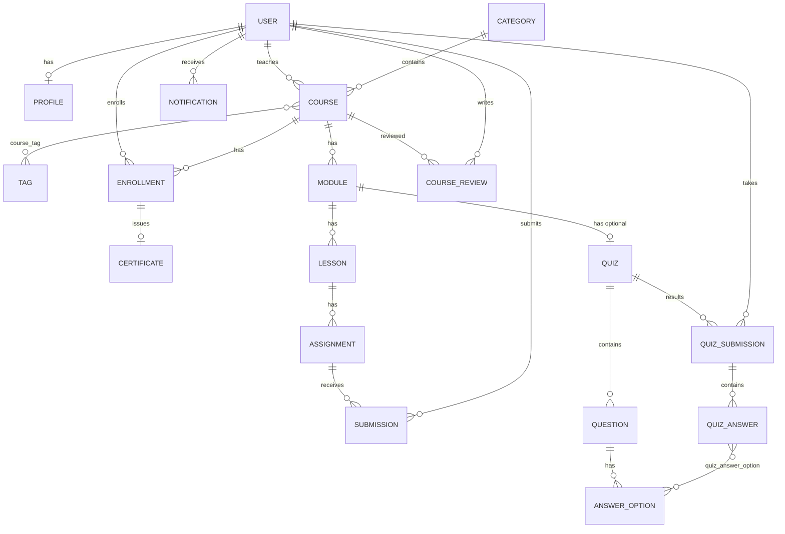

# Learning Platform — учебная платформа по ORM и Hibernate

[](https://github.com/tthreeonek/learning-platform/actions/workflows/ci.yml)

Веб-приложение на **Spring Boot 3.5 + Spring Data JPA (Hibernate 6.6) + PostgreSQL 17** для управления онлайн-курсами:
курсы → модули → уроки, запись студентов, домашние задания и их проверка, тесты с автоматической проверкой,
отзывы, уведомления, сертификаты и аналитика успеваемости.

| | |
|---|---|
| Java | 21 |
| Сборка | Maven (checkstyle → unit-тесты → интеграционные тесты → JaCoCo) |
| БД | PostgreSQL 17, схема создаётся Hibernate (`ddl-auto`) |
| API | REST + Swagger UI (`/swagger-ui.html`) + простая веб-страница (`/`) |
| Тесты | 88: 29 юнит-тестов (JUnit 5 + Mockito) и 59 интеграционных (Testcontainers PostgreSQL), покрытие строк ~97 % |
| DevOps | Dockerfile, docker-compose, GitHub Actions |

## Содержание

1. [Быстрый старт](#быстрый-старт)
2. [Конфигурация и профили](#конфигурация-и-профили)
3. [Модель данных](#модель-данных)
4. [Ленивая загрузка](#ленивая-загрузка-и-как-она-решается)
5. [REST API](#rest-api)
6. [Обработка ошибок и валидация](#обработка-ошибок-и-валидация)
7. [Демо-данные](#демо-данные)
8. [Тестирование](#тестирование)
9. [CI/CD](#cicd)
10. [Структура проекта](#структура-проекта)

## Быстрый старт

### Вариант 1. Docker Compose (ничего, кроме Docker, не нужно)

```bash
git clone https://github.com/tthreeonek/learning-platform.git
cd learning-platform
cp .env.example .env          # необязательно: без .env используются значения по умолчанию
docker compose up -d --build
```

Через ~30 секунд:

* веб-страница — http://localhost:8080/
* Swagger UI — http://localhost:8080/swagger-ui.html
* health — http://localhost:8080/actuator/health

База сразу наполнена демо-данными (см. [Демо-данные](#демо-данные)). Остановить: `docker compose down` (с удалением данных — `down -v`).

### Вариант 2. Локально через Maven

Нужны JDK 21 и PostgreSQL (можно поднять только БД: `docker compose up -d postgres`).

```bash
# профиль dev по умолчанию: jdbc:postgresql://localhost:5432/learning, пользователь/пароль learning/learning
mvn spring-boot:run

# или с собственной БД
DB_URL=jdbc:postgresql://host:5432/db DB_USERNAME=user DB_PASSWORD=secret mvn spring-boot:run
```

Создавать таблицы вручную не нужно: при старте Hibernate создаёт/обновляет схему по сущностям (`ddl-auto=update`).

## Конфигурация и профили

Параметры подключения в коде не хранятся — только в `application*.yml` через переменные окружения.

| Файл | Назначение |
|---|---|
| `application.yml` | общие настройки: `spring.datasource.*` = `${DB_URL}`, `${DB_USERNAME}`, `${DB_PASSWORD}`; `open-in-view: false`; `ddl-auto: ${JPA_DDL_AUTO:update}` |
| `application-dev.yml` | профиль по умолчанию для разработки: значения по умолчанию для локальной БД, DEBUG-логи |
| `application-prod.yml` | запуск в Docker/на сервере: **без значений по умолчанию** — всё приходит из окружения (`.env`) |
| `src/test/resources/application-test.yml` | тесты: PostgreSQL в Testcontainers (URL подставляет `@ServiceConnection`), `ddl-auto: create-drop`, сидер выключен |

| Переменная | По умолчанию (dev) | Описание |
|---|---|---|
| `DB_URL` | `jdbc:postgresql://localhost:5432/learning` | JDBC URL |
| `DB_USERNAME` / `DB_PASSWORD` | `learning` / `learning` | учётные данные БД |
| `JPA_DDL_AUTO` | `update` | стратегия создания схемы |
| `APP_SEED_ENABLED` | `true` | наполнять ли пустую БД демо-данными |
| `SERVER_PORT` | `8080` | порт приложения |
| `JPA_SHOW_SQL` | `false` | печатать SQL (удобно смотреть N+1 и ленивую загрузку) |

## Модель данных

18 сущностей JPA (пакет `entity`) и 2 таблицы связей «многие ко многим»:

| Сущность (таблица) | Ключевые поля | Связи |
|---|---|---|
| `User` (`users`) | name, email (unique), role: STUDENT/TEACHER/ADMIN | 1-1 Profile; 1-M Course (teacher), Enrollment, Submission, QuizSubmission, CourseReview, Notification |
| `Profile` (`profiles`) | user_id (unique), bio, avatarUrl, phone, city | **1-1** User |
| `Category` (`categories`) | name (unique), description | 1-M Course |
| `Tag` (`tags`) | name (unique) | **M-M** Course через `course_tag` |
| `Course` (`courses`) | title, description, category_id, teacher_id, durationHours, startDate | M-1 Category, M-1 User; 1-M CourseModule, Enrollment, CourseReview; M-M Tag |
| `Enrollment` (`enrollments`) | student_id, course_id (unique пара), enrolledAt, status | **M-M** User↔Course с атрибутами; 1-1 Certificate |
| `Certificate` (`certificates`) | enrollment_id (unique), code (unique), finalScore | **1-1** Enrollment |
| `CourseModule` (`modules`) | course_id, title, orderIndex | M-1 Course; 1-M Lesson; **1-1** Quiz |
| `Lesson` (`lessons`) | module_id, title, content, videoUrl, orderIndex | M-1 CourseModule; 1-M Assignment |
| `Assignment` (`assignments`) | lesson_id, title, description, dueDate, maxScore | M-1 Lesson; 1-M Submission |
| `Submission` (`submissions`) | assignment_id, student_id (unique пара), content, score, feedback, status | **M-M** User↔Assignment с атрибутами |
| `Quiz` (`quizzes`) | module_id (unique), title, timeLimit, passingScore | 1-1 CourseModule; 1-M Question, QuizSubmission |
| `Question` (`questions`) | quiz_id, text, type: SINGLE/MULTIPLE_CHOICE | M-1 Quiz; 1-M AnswerOption |
| `AnswerOption` (`answer_options`) | question_id, text, isCorrect | M-1 Question |
| `QuizSubmission` (`quiz_submissions`) | quiz_id, student_id, score, maxScore, percent, passed, takenAt | M-1 Quiz, M-1 User; 1-M QuizAnswer |
| `QuizAnswer` (`quiz_answers`) | quiz_submission_id, question_id, correct | M-1 QuizSubmission, M-1 Question; **M-M** AnswerOption через `quiz_answer_option` |
| `CourseReview` (`course_reviews`) | course_id, student_id (unique пара), rating 1–5, comment | M-1 Course, M-1 User |
| `Notification` (`notifications`) | user_id, type, message, isRead | M-1 User |



### Каскады и удаление

| Операция | Поведение |
|---|---|
| Сохранение курса | модули, уроки (и тест модуля) сохраняются каскадно (`CascadeType.ALL`) |
| Удаление курса | **запрещено (409)**, если на курс записаны студенты; иначе каскадно удаляются модули → уроки → задания → решения, тесты → вопросы → варианты → попытки, отзывы; строки `course_tag` удаляются, сами теги остаются |
| Удаление модуля / урока / задания | каскадно удаляет вложенную структуру (`orphanRemoval`) |
| Удаление пользователя | каскадно: профиль, записи (и сертификаты), решения, результаты тестов, отзывы, уведомления. Преподавателя с курсами удалить нельзя (409) |
| Удаление категории | запрещено, если в ней есть курсы |
| Удаление тега | удаляются только связи `course_tag` |
| M-M связи (`tags`, `selectedOptions`) | **без каскада** — удаление курса не трогает теги, удаление попытки не трогает варианты ответов |

Уникальность защищена дважды: проверкой в сервисе (понятная ошибка 409) и ограничением в БД
(`uk_enrollment_student_course`, `uk_submission_assignment_student`, `uk_review_course_student`, `users.email`).

## Ленивая загрузка и как она решается

Все связи явно объявлены `fetch = FetchType.LAZY`, включая `@ManyToOne` и `@OneToOne` (по стандарту JPA они EAGER).
`spring.jpa.open-in-view=false`, поэтому сессия Hibernate закрывается вместе с транзакцией сервиса —
обращение к незагруженной связи за её пределами даёт `LazyInitializationException`. Это показано тестом
[`LazyLoadingIT`](src/test/java/ru/hw/learning/integration/LazyLoadingIT.java):

```java
Course course = courseRepository.findById(id).orElseThrow();   // транзакция репозитория закрыта
course.getModules().size();          // LazyInitializationException: ... Course.modules ... no session
course.getTeacher().getName();       // LazyInitializationException: прокси @ManyToOne(LAZY)
```

Как это решено в приложении:

| Способ | Где используется |
|---|---|
| `JOIN FETCH` в JPQL | `CourseRepository.findWithModulesById`, `CourseModuleRepository.findWithLessonsByCourseId`, `QuestionRepository.findWithOptionsByQuizId`, `AssignmentRepository.findWithCourseById` |
| `@EntityGraph` | `CourseRepository.findDetailedById` (категория, преподаватель, теги), `EnrollmentRepository.findAllByCourseId…` (студенты), `SubmissionRepository.findAllBy…` |
| Транзакционный сервис + DTO | все сервисы помечены `@Transactional(readOnly = true)` и возвращают DTO, а не сущности: контроллер никогда не трогает ленивые прокси |
| Две выборки вместо одной | курс → модули → уроки — это две коллекции-`List` (bag); один `JOIN FETCH` на обе даёт `MultipleBagFetchException`, поэтому `CourseService.getStructure` делает два запроса |
| `default_batch_fetch_size: 25` | смягчает N+1, когда ленивые коллекции всё же догружаются внутри транзакции |

Замечание: обратная сторона `@OneToOne(mappedBy)` (`User.profile`, `CourseModule.quiz`) в Hibernate без
bytecode enhancement всё равно загружается отдельным запросом — прокси для неё создать нельзя, т.к. Hibernate
не знает, есть ли связанная запись. Поэтому профиль хранится отдельно и для страницы пользователя
загружается явно через `@EntityGraph` (`UserRepository.findWithProfileById`).

## REST API

Полная интерактивная документация — **Swagger UI**: http://localhost:8080/swagger-ui.html
(OpenAPI JSON: `/v3/api-docs`). Создание возвращает `201 Created` + заголовок `Location`, удаление — `204 No Content`.

### Пользователи — `/api/users`

| Метод | URL | Описание |
|---|---|---|
| POST | `/api/users` | создать пользователя `{name, email, role}` |
| GET | `/api/users?role=STUDENT` | список (фильтр по роли) |
| GET / PUT / DELETE | `/api/users/{id}` | получить (с профилем) / обновить / удалить |
| PUT | `/api/users/{id}/profile` | создать или обновить профиль (1-1) |
| GET | `/api/users/{id}/courses` | курсы, на которые записан студент |
| GET | `/api/users/{id}/enrollments` | записи студента со статусами |
| GET | `/api/users/{id}/assignments` | задания всех курсов студента |
| GET | `/api/users/{id}/submissions` | решения студента с оценками |
| GET | `/api/users/{id}/quiz-results` | результаты тестов студента |
| GET | `/api/users/{id}/notifications` | уведомления |
| GET | `/api/users/{id}/progress` | успеваемость по всем курсам (аналитика) |

### Курсы — `/api/courses`

| Метод | URL | Описание |
|---|---|---|
| POST | `/api/courses` | создать курс (можно сразу с `modules[].lessons[]` и `tags[]`) |
| GET | `/api/courses?categoryId=&teacherId=&tag=&title=` | поиск |
| GET / PUT / DELETE | `/api/courses/{id}` | карточка / обновить (описание, категорию, преподавателя, теги) / удалить |
| GET | `/api/courses/{id}/structure` | полная структура: модули → уроки |
| GET / POST | `/api/courses/{id}/modules` | модули курса / добавить модуль |
| POST / DELETE | `/api/courses/{id}/enroll?userId={userId}` | записать / отписать студента |
| GET | `/api/courses/{id}/students` | студенты курса |
| GET | `/api/courses/{id}/enrollments` | записи на курс |
| GET / POST | `/api/courses/{id}/reviews` | отзывы / оставить отзыв |
| GET | `/api/courses/{id}/quiz-results` | результаты всех тестов курса |
| GET | `/api/courses/{id}/stats` | статистика курса |
| GET | `/api/courses/{id}/leaderboard` | рейтинг студентов курса |

### Контент, задания, тесты

| Метод | URL | Описание |
|---|---|---|
| GET / PUT / DELETE | `/api/modules/{id}` | модуль (с уроками) |
| GET / POST | `/api/modules/{id}/lessons` | уроки модуля / добавить урок |
| POST | `/api/modules/{id}/quiz` | создать тест модуля с вопросами и вариантами |
| GET / PUT / DELETE | `/api/lessons/{id}` | урок |
| GET / POST | `/api/lessons/{id}/assignments` | задания урока / добавить задание |
| GET / PUT / DELETE | `/api/assignments/{id}` | задание |
| POST | `/api/assignments/{id}/submit` | отправить решение `{studentId, content}` |
| GET | `/api/assignments/{id}/submissions` | все решения по заданию |
| GET / DELETE | `/api/submissions/{id}` | решение / отозвать (до проверки) |
| PUT | `/api/submissions/{id}/grade` | оценить `{score, feedback}` |
| GET | `/api/quizzes/{id}?withAnswers=false` | тест (студенту правильные ответы не показываются) |
| POST | `/api/quizzes/{id}/take` | пройти тест `{studentId, answers: {questionId: [optionId]}}` |
| GET | `/api/quizzes/{id}/results` | результаты теста |
| DELETE | `/api/quizzes/{id}` | удалить тест |

### Прочее

| Метод | URL | Описание |
|---|---|---|
| GET / POST | `/api/categories`, `/api/categories/{id}` (+PUT, DELETE) | категории |
| GET / POST / DELETE | `/api/tags`, `/api/tags/{id}` | теги |
| GET | `/api/enrollments/{id}` | запись на курс |
| POST | `/api/enrollments/{id}/complete` | завершить курс, выдать сертификат |
| GET | `/api/certificates/{code}` | проверить сертификат |
| DELETE | `/api/reviews/{id}` | удалить отзыв |
| PUT | `/api/notifications/{id}/read` | отметить уведомление прочитанным |

### Пример сценария (curl)

```bash
# курс со структурой
curl -s -X POST localhost:8080/api/courses -H 'Content-Type: application/json' -d '{
  "title":"Hibernate за неделю","categoryId":1,"teacherId":2,"tags":["Java","Hibernate"],
  "modules":[{"title":"Введение","lessons":[{"title":"ORM"},{"title":"JPA"}]}]}'

curl -s -X POST 'localhost:8080/api/courses/4/enroll?userId=5'                 # запись студента
curl -s localhost:8080/api/courses/4/structure                                  # модули и уроки
curl -s -X POST localhost:8080/api/lessons/14/assignments -H 'Content-Type: application/json' \
     -d '{"title":"ДЗ","maxScore":10}'                                          # задание
curl -s -X POST localhost:8080/api/assignments/6/submit -H 'Content-Type: application/json' \
     -d '{"studentId":5,"content":"моё решение"}'                               # решение
curl -s -X PUT localhost:8080/api/submissions/6/grade -H 'Content-Type: application/json' \
     -d '{"score":9,"feedback":"Отлично"}'                                      # оценка
curl -s localhost:8080/api/users/5/progress                                     # успеваемость
```

## Обработка ошибок и валидация

Входные DTO проверяются Bean Validation (`@NotBlank`, `@Email`, `@Size`, `@Min/@Max`, `@Pattern`, вложенный `@Valid`).
Ошибки обрабатываются централизованно в
[`GlobalExceptionHandler`](src/main/java/ru/hw/learning/exception/GlobalExceptionHandler.java) (`@RestControllerAdvice`)
и возвращаются в едином формате:

```json
{
  "timestamp": "2026-11-19T12:00:00Z",
  "status": 400,
  "error": "Bad Request",
  "message": "Ошибка валидации запроса",
  "path": "/api/users",
  "fieldErrors": [ { "field": "email", "message": "Некорректный email" } ]
}
```

| Код | Когда |
|---|---|
| 400 | ошибка валидации, неверный JSON, неверный тип или отсутствие параметра |
| 404 | сущность не найдена (`NotFoundException`) |
| 409 | дубликат (повторная запись, повторное решение, занятый email), удаление при наличии зависимостей, нарушение ограничения БД |
| 422 | нарушение бизнес-правила: неверная роль, студент не записан на курс, истёк срок сдачи, балл выше максимума |
| 500 | непредвиденная ошибка (логируется со стектрейсом, клиенту — общее сообщение) |

Все создания, изменения и удаления логируются (SLF4J), ошибки 5xx — с уровнем ERROR.

## Демо-данные

При первом запуске на пустой БД [`DataSeeder`](src/main/java/ru/hw/learning/seed/DataSeeder.java) создаёт данные
через сервисный слой (те же проверки, что в API). Повторный запуск данные не дублирует. Отключить: `APP_SEED_ENABLED=false`.

| | |
|---|---|
| Пользователи | администратор, 2 преподавателя (Ирина Соколова, Алексей Морозов), 4 студента (Анна, Иван, Мария, Дмитрий) |
| Категории / теги | Программирование, Базы данных, DevOps / Java, Hibernate, ORM, Spring, SQL, PostgreSQL, Beginner |
| Курсы | «Основы Hibernate» (3 модуля), «Spring Data JPA на практике» (2), «PostgreSQL для разработчиков» (2) — всего 13 уроков |
| Учебный процесс | 6 записей, 5 заданий, 5 решений (3 оценены), 3 теста, 5 попыток тестов, 3 отзыва, 1 сертификат, уведомления |

## Тестирование

```bash
mvn test      # checkstyle + юнит-тесты (без Docker)
mvn verify    # + интеграционные тесты на PostgreSQL в Testcontainers (нужен Docker) + отчёт JaCoCo
```

Отчёт о покрытии: `target/site/jacoco/index.html` (сборка падает, если покрытие строк < 85 %; сейчас ~97 %).

**Юнит-тесты** (`src/test/java/.../service/*Test`, JUnit 5 + Mockito, без Spring и БД):

| Класс | Что проверяет |
|---|---|
| `QuizGraderTest` | подсчёт баллов: одиночный/множественный выбор, пропущенные вопросы, чужие id, округление, порог |
| `ProgressCalculatorTest` | итоговый процент по заданиям и лучшим попыткам тестов |
| `EnrollmentServiceTest` | дубликат записи, роль, 404, отмена, завершение |
| `SubmissionServiceTest` | дубликат решения, дедлайн (фиксированные `Clock`), запись на курс, оценка > max |
| `CourseServiceTest`, `UserServiceTest` | роль преподавателя, удаление курса со студентами, уникальность email |
| `GlobalExceptionHandlerTest` | коды 404/409/422/500 и отсутствие технических деталей в ответе |

**Интеграционные тесты** (`src/test/java/.../integration/*IT`, `@SpringBootTest` + PostgreSQL 17 в Testcontainers):

| Класс | Сценарии |
|---|---|
| `SchemaIT` | схема создана: 18 таблиц сущностей + 2 таблицы M-M, внешние ключи, уникальные ограничения |
| `CourseCrudIT` | **C**: каскадное сохранение курс→модули→уроки; **R**: структура, поиск; **U**: описание, преподаватель, теги, новые модули; **D**: каскадное удаление, запрет при наличии студентов, `orphanRemoval`, удаление тега и категории |
| `LazyLoadingIT` | `LazyInitializationException` для коллекции, прокси `@ManyToOne` и вложенной коллекции; исправления через JOIN FETCH, `@EntityGraph`, транзакцию |
| `UserCrudIT` | профиль 1-1, уникальность email (сервис и БД), каскадное удаление студента, запрет удаления преподавателя |
| `EnrollmentIT` | запись, дубликат (сервис и уникальный индекс), роли, списки студентов/курсов, отписка, сертификат |
| `SubmissionIT` | уведомление о задании, отправка → оценка, повтор, не записан, дедлайн, балл > max, удаление |
| `QuizIT` | каскадное создание теста, подсчёт и сохранение ответов, результаты по тесту/студенту/курсу, 1-1 модуль-тест, удаление курса с попытками |
| `RestApiIT` | сквозной сценарий через HTTP (MockMvc) и коды 201/204/400/404/409/422 |
| `RestEndpointsIT` | все эндпоинты API на демо-данных: GET, PUT, POST, DELETE, аналитика, сертификат, 405/404 |
| `DataSeederIT` | демо-данные загружаются во все таблицы и не дублируются |

## CI/CD

[`.github/workflows/ci.yml`](.github/workflows/ci.yml) запускается на каждый push и pull request:

1. **build** — `mvn verify`: Checkstyle (правила в [`checkstyle.xml`](checkstyle.xml)) → юнит-тесты → интеграционные тесты
   с Testcontainers → JaCoCo (порог 85 %); отчёты тестов и покрытия сохраняются как артефакты;
2. **docker** — сборка образа и smoke-тест: `docker compose up`, ожидание `/actuator/health`, запрос `/api/courses`.

Образ собирается [`Dockerfile`](Dockerfile) в два этапа (Maven → JRE 21 alpine), запускается от непривилегированного
пользователя, с `HEALTHCHECK`.

## Структура проекта

```
src/main/java/ru/hw/learning
├── LearningPlatformApplication.java
├── config/        AppConfig — бины Clock и OpenAPI
├── entity/        18 сущностей JPA + перечисления (Role, EnrollmentStatus, ...)
├── repository/    18 репозиториев Spring Data JPA (JOIN FETCH, @EntityGraph, агрегаты)
├── service/       бизнес-логика: курсы, контент, записи, задания, решения, тесты, отзывы, аналитика
├── mapper/        сущность -> DTO (вызываются внутри транзакции)
├── web/dto/       запросы и ответы API (record + Bean Validation)
├── web/controller/ REST-контроллеры
├── exception/     исключения и GlobalExceptionHandler (@RestControllerAdvice)
└── seed/          DataSeeder — демо-данные
src/main/resources
├── application.yml, application-dev.yml, application-prod.yml
└── static/index.html — простая веб-страница: курсы, структура, рейтинг, запись на курс
src/test/java/ru/hw/learning
├── service/       юнит-тесты
├── integration/   интеграционные тесты (*IT)
└── support/       IntegrationTestBase (Testcontainers), TestDataFactory
```

Слои: **controller** (HTTP, валидация) → **service** (транзакции, правила, DTO) → **repository** (доступ к данным) → **entity**.
Контроллеры не работают с сущностями, сервисы не знают про HTTP, зависимости внедряются через конструктор.
